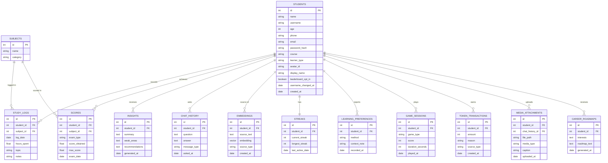

# AI-Powered Student Self-Monitoring & Performance Analysis System
## Architecture & Database Design Document

---

## 1. Overview

The system lets students log daily academic activity (study hours, scores, subjects) and receive AI-generated feedback on their patterns and weak areas. It has four moving parts: a browser frontend, a Java backend for core data/business logic, a Flask microservice for AI/RAG analysis, and a PostgreSQL database (using the `pgvector` extension to also hold RAG embeddings). See the architecture diagram above for how they connect.

---

## 2. Why split Java and Flask this way

| Concern | Owner | Reasoning |
|---|---|---|
| Auth, student CRUD, activity/score logging, dashboards data | **Java (Spring Boot)** | Strong typing, mature ORM (Hibernate/JPA), predictable REST conventions — ideal for the transactional core that Postgres backs directly. |
| RAG pipeline, embeddings, LLM prompt construction, NLP preprocessing | **Flask (Python)** | Python's AI ecosystem (LangChain, sentence-transformers, OpenAI/Anthropic SDKs) is far ahead of Java's here. Keeping it isolated means AI logic can iterate fast (e.g. in Colab first) without touching the stable core API. |

**Contract between them:** Java is the only service the frontend calls. When a student requests insights, Java calls Flask internally (`POST /analyze`) with the student's recent data, Flask returns a JSON verdict, Java stores it and relays it to the frontend. Both Java and Flask connect to the same Postgres instance — Java owns the relational tables (students, logs, scores, insights), Flask owns the `embeddings` table it uses for vector search via `pgvector`. Keeping both in one database means no separate vector-store server to run, back up, or deploy alongside everything else.

If you want to simplify to a single language for your first working version, dropping Flask and doing RAG calls directly from Java (via HTTP to the LLM API, skipping a Python layer) is a legitimate scope-reduction — but you lose the Python AI ecosystem, so I'd only recommend that if you're short on time before a deadline.

---

## 3. Component responsibilities

**Implementation status:** `/api/checkin` (Java) and `/checkin` (Flask, using a local Ollama model) are built and working — see `backend-java/` and `ai-service-flask/`. Everything else below is still design-only, not yet coded.

- **Frontend** — HTML5/Tailwind/JS pages: sign up / login, daily activity table (self-view of logs + scores), Chart.js dashboard (line chart for score trend, bar chart for study hours by subject, radar chart for subject-wise strength), opt-in leaderboard, a small games/mind-refresh section, and an animated mascot that reacts to streaks and progress. See §8 for details on the gamification pieces.
- **Java Spring Boot API** — REST endpoints, JWT auth, validation, Postgres access (relational tables), orchestrates calls to Flask.
- **Flask AI microservice** — builds the RAG pipeline: embeds the student's historical logs + any reference material (study tips, syllabus notes), retrieves relevant context via `pgvector` similarity search, prompts the LLM, returns structured suggestions.
- **PostgreSQL + pgvector** — single database serving two roles: system of record for all transactional data (students, logs, scores, insights), and vector store for RAG embeddings via the `pgvector` extension (`vector` column type + `<=>` cosine-distance operator). Replaces what would otherwise be a separate FAISS/Chroma service.
- **LLM API** — external call (OpenAI, Anthropic, or a local model via Ollama if you want zero API cost during development).

---

## 4. Database design

### 4.1 Entity-relationship diagram



### 4.2 SQL schema (PostgreSQL DDL)

```sql
-- Enable pgvector once per database
CREATE EXTENSION IF NOT EXISTS vector;

CREATE TABLE students (
  id SERIAL PRIMARY KEY,
  name VARCHAR(100) NOT NULL,
  username VARCHAR(30) NOT NULL UNIQUE,
  age INT CHECK (age BETWEEN 5 AND 100),
  phone VARCHAR(15),
  email VARCHAR(150) NOT NULL UNIQUE,
  password_hash VARCHAR(255) NOT NULL,
  course VARCHAR(100),
  learner_type VARCHAR(20) CHECK (learner_type IN ('school', 'university', 'coaching', 'online_self_learner')),
  avatar_id VARCHAR(20) DEFAULT 'avatar_1',
  display_name VARCHAR(50), -- shown on leaderboard instead of real name if student wants
  leaderboard_opt_in BOOLEAN NOT NULL DEFAULT FALSE, -- opt-in, per your decision
  username_changed_at TIMESTAMP DEFAULT CURRENT_TIMESTAMP, -- used to enforce the 14-day cooldown
  created_at TIMESTAMP DEFAULT CURRENT_TIMESTAMP
);

CREATE TABLE subjects (
  id SERIAL PRIMARY KEY,
  name VARCHAR(100) NOT NULL,
  category VARCHAR(50)
);

CREATE TABLE study_logs (
  id SERIAL PRIMARY KEY,
  student_id INT NOT NULL REFERENCES students(id) ON DELETE CASCADE,
  subject_id INT NOT NULL REFERENCES subjects(id),
  log_date DATE NOT NULL,
  hours_spent DECIMAL(4,2) NOT NULL,
  topic VARCHAR(200),
  notes TEXT
);

CREATE TABLE scores (
  id SERIAL PRIMARY KEY,
  student_id INT NOT NULL REFERENCES students(id) ON DELETE CASCADE,
  subject_id INT NOT NULL REFERENCES subjects(id),
  exam_type VARCHAR(50),
  score_obtained DECIMAL(5,2) NOT NULL,
  max_score DECIMAL(5,2) NOT NULL,
  exam_date DATE NOT NULL
);

CREATE TABLE insights (
  id SERIAL PRIMARY KEY,
  student_id INT NOT NULL REFERENCES students(id) ON DELETE CASCADE,
  summary TEXT,
  weak_areas TEXT,
  recommendations TEXT,
  generated_at TIMESTAMP DEFAULT CURRENT_TIMESTAMP
);

CREATE TABLE chat_history (
  id SERIAL PRIMARY KEY,
  student_id INT NOT NULL REFERENCES students(id) ON DELETE CASCADE,
  question TEXT,
  answer TEXT,
  message_type VARCHAR(20) DEFAULT 'question', -- 'question' | 'daily_checkin' | 'confusion_help'
  asked_at TIMESTAMP DEFAULT CURRENT_TIMESTAMP
);

-- RAG embeddings, owned by the Flask service.
-- 384 dims fits a small sentence-transformers model (e.g. all-MiniLM-L6-v2);
-- use 1536 if you embed with an OpenAI-style embedding API instead.
CREATE TABLE embeddings (
  id SERIAL PRIMARY KEY,
  student_id INT REFERENCES students(id) ON DELETE CASCADE,
  source_text TEXT NOT NULL,
  embedding VECTOR(384) NOT NULL,
  source_type VARCHAR(50), -- e.g. 'study_log', 'score', 'reference_material'
  created_at TIMESTAMP DEFAULT CURRENT_TIMESTAMP
);

-- Approximate nearest-neighbour index for fast cosine-similarity search
CREATE INDEX embeddings_vector_idx ON embeddings
  USING ivfflat (embedding vector_cosine_ops) WITH (lists = 100);

-- One row per student, updated whenever they log an activity
CREATE TABLE streaks (
  id SERIAL PRIMARY KEY,
  student_id INT NOT NULL UNIQUE REFERENCES students(id) ON DELETE CASCADE,
  current_streak INT NOT NULL DEFAULT 0,
  longest_streak INT NOT NULL DEFAULT 0,
  last_active_date DATE
);

-- "How did you learn this?" — can be asked once at onboarding and/or
-- attached per study_log entry if you want it granular rather than a one-time survey
CREATE TABLE learning_preferences (
  id SERIAL PRIMARY KEY,
  student_id INT NOT NULL REFERENCES students(id) ON DELETE CASCADE,
  method VARCHAR(30) NOT NULL, -- 'tutorials' | 'notes' | 'practice' | 'college' | 'peers' | 'other'
  context_note TEXT,
  recorded_at TIMESTAMP DEFAULT CURRENT_TIMESTAMP
);

CREATE TABLE game_sessions (
  id SERIAL PRIMARY KEY,
  student_id INT NOT NULL REFERENCES students(id) ON DELETE CASCADE,
  game_type VARCHAR(50) NOT NULL, -- e.g. 'flashcard_match', 'quick_quiz', 'memory_grid'
  score INT,
  duration_seconds INT,
  played_at TIMESTAMP DEFAULT CURRENT_TIMESTAMP
);

-- Token economy: every earn/spend is a row, current balance = SUM(amount).
-- Positive amount = earned, negative = spent (e.g. on a streak freeze).
CREATE TABLE token_transactions (
  id SERIAL PRIMARY KEY,
  student_id INT NOT NULL REFERENCES students(id) ON DELETE CASCADE,
  amount INT NOT NULL, -- e.g. +10 for daily log, -50 to freeze a streak
  reason VARCHAR(100) NOT NULL, -- 'daily_log', 'streak_freeze_purchase', 'game_win', 'weekly_bonus'
  source_type VARCHAR(30), -- 'log' | 'game' | 'streak' | 'redemption'
  created_at TIMESTAMP DEFAULT CURRENT_TIMESTAMP
);

-- Screenshots / images the student attaches to a chat message
-- (e.g. terminal output, a YouTube tutorial screenshot)
CREATE TABLE media_attachments (
  id SERIAL PRIMARY KEY,
  student_id INT NOT NULL REFERENCES students(id) ON DELETE CASCADE,
  chat_history_id INT REFERENCES chat_history(id) ON DELETE CASCADE,
  file_path VARCHAR(255) NOT NULL, -- disk path or object-storage key, not the file itself
  media_type VARCHAR(30), -- 'screenshot' | 'code' | 'youtube_thumbnail'
  caption VARCHAR(200),
  uploaded_at TIMESTAMP DEFAULT CURRENT_TIMESTAMP
);

-- AI-generated career roadmap, regenerated whenever the student asks
-- or after enough new activity has accumulated
CREATE TABLE career_roadmaps (
  id SERIAL PRIMARY KEY,
  student_id INT NOT NULL REFERENCES students(id) ON DELETE CASCADE,
  interests TEXT, -- free-text or comma list the student provided
  roadmap_text TEXT,
  generated_at TIMESTAMP DEFAULT CURRENT_TIMESTAMP
);
```

Indexes worth adding once you have real data volume: `(student_id, log_date)` on `study_logs` and `(student_id, exam_date)` on `scores`, since the dashboard queries will always filter by student and sort by date. The `ivfflat` index on `embeddings` needs at least a few hundred rows before it's worth building — for a small student project it's fine to skip it and let pgvector do an exact scan.

**Example similarity query** (what Flask runs for retrieval):
```sql
SELECT source_text, embedding <=> '[0.12, -0.05, ...]'::vector AS distance
FROM embeddings
WHERE student_id = 42
ORDER BY distance
LIMIT 5;
```

---

## 5. API contract

### 5.1 Java Spring Boot (public-facing)

| Method | Endpoint | Purpose |
|---|---|---|
| POST | `/api/auth/register` | Create student account |
| POST | `/api/auth/login` | Return JWT |
| PUT | `/api/students/{id}/username` | Change username — rejected (409) if `username_changed_at` is less than 14 days ago, or if the new username is already taken |
| POST | `/api/logs` | Log a study session |
| GET | `/api/logs?studentId=` | Fetch logs for dashboard |
| POST | `/api/scores` | Record an exam/test score |
| GET | `/api/scores?studentId=` | Fetch scores for dashboard |
| GET | `/api/dashboard/summary?studentId=` | Aggregated stats for Chart.js |
| POST | `/api/insights/generate?studentId=` | Triggers Flask analysis, stores + returns result |
| GET | `/api/insights?studentId=` | Fetch past insights |
| POST | `/api/chat` | Student asks a free-text question, proxied to Flask RAG |
| GET | `/api/leaderboard` | Ranked list of opted-in students (display_name + aggregate score) |
| PUT | `/api/students/{id}/leaderboard-opt-in` | Toggle opt-in + set display_name |
| GET | `/api/streaks?studentId=` | Current + longest streak, used to drive mascot state |
| POST | `/api/learning-preferences` | Record how the student says they learned |
| POST | `/api/games/sessions` | Log a completed mini-game result |
| GET | `/api/games/leaderboard?gameType=` | Optional: per-game leaderboard, same opt-in rule applies |
| POST | `/api/checkin` | Daily "how was your day" conversation turn — proxied to Flask, stored with `message_type='daily_checkin'` |
| POST | `/api/chat/media` | Upload a screenshot/image alongside a chat message (multipart), stores a `media_attachments` row |
| GET | `/api/tokens/balance?studentId=` | Current token balance (`SUM(amount)` from `token_transactions`) |
| POST | `/api/tokens/redeem` | Spend tokens — e.g. `{ studentId, reason: 'streak_freeze_purchase' }`, inserts a negative transaction and applies the effect |
| POST | `/api/career-roadmap/generate?studentId=` | Triggers Flask to build a roadmap from interests + activity history |
| GET | `/api/career-roadmap?studentId=` | Fetch the latest saved roadmap |

### 5.2 Flask AI microservice (internal only, called by Java)

| Method | Endpoint | Purpose |
|---|---|---|
| POST | `/analyze` | Body: student's logs + scores (JSON). Returns weak-area summary + recommendations. |
| POST | `/chat` | Body: question + student context. Returns RAG-grounded answer. |
| POST | `/checkin` | Body: student's recent logs + their free-text answer to "how was your day". Returns a warm, specific reply — this is the Flask side of `/api/checkin`. |
| POST | `/suggest-resources` | Body: a confusion topic/question. Returns 2–3 relevant links (websites/tutorials) — see §8.4 for how to source these responsibly. |
| POST | `/career-roadmap` | Body: interests + activity history summary. Returns a structured roadmap (stages, skills, suggested next steps). |
| POST | `/embed` | (internal/admin) Re-index reference material into the vector store. |

Keep Flask off the public internet in deployment — Java is the only caller. For a college project running locally, this can just mean Flask listens on `127.0.0.1` or an internal Docker network.

---

## 6. Gamification & engagement features

### 6.1 Streak system
- `streaks.current_streak` increments when a student logs at least one activity (`study_logs` or `scores`) on a new calendar day, following a day they were also active.
- If a day passes with no activity, a scheduled job (or a check-on-login) resets `current_streak` to 0 and records `longest_streak` if the broken streak was a new record.
- Simplest implementation for a student project: check `last_active_date` whenever the student logs in or logs an activity — no need for a real cron job unless you want streaks to break at midnight even if the student doesn't open the app.

### 6.2 Mascot animations
Pure frontend — no backend changes needed beyond the streak data you already have.
- Fetch `/api/streaks` on dashboard load. Map streak state to a mascot mood: growing streak → happy/celebrating, streak just broken → sad, no change → neutral/idle.
- A few small looping animations cover most of it: idle, happy-bounce, sad-droop, celebrate-burst. Lottie (free animations from LottieFiles, played via `lottie-web` from a CDN) is the fastest way to get a polished cartoon character without drawing frame-by-frame yourself; a hand-drawn CSS/SVG character is more work but fully custom.
- Trigger the celebrate animation on: new personal-best streak, first log of the day, or a score improvement over the student's own last attempt in that subject — small, frequent wins land better than only celebrating big milestones.

### 6.3 Competitive score tracker (leaderboard)
- Ranks by an aggregate metric — e.g. average score percentage over the last 30 days, or total study hours — computed from `scores`/`study_logs`, not stored separately.
- Only students with `leaderboard_opt_in = true` appear; the entry shows `display_name` (never `name`/`email`) so opting in doesn't leak identity if a student picks a nickname.
- Show the student's own rank even if they're not opted in ("You'd be ranked #7") — that's motivating without violating their privacy choice.

### 6.4 Game-based / mind-refresh activities
Small, low-stakes games break up study sessions and are easy to scope for a project:
- **Flashcard match** — pairs from the student's own weak-area terms (pulled from `insights.weak_areas`) — ties the game back into the AI analysis rather than being disconnected fluff.
- **Quick quiz** — 5 rapid-fire questions on a subject, auto-scored, logged to `game_sessions`.
- **Memory grid / reaction game** — pure mind-refresh, no academic content, for a genuine break.
Each session logs to `game_sessions`, which can optionally feed its own mini-leaderboard.

### 6.5 "How did you learn this?" survey
- Simplest version: ask once at onboarding (a single `learning_preferences` row per student) with options tutorials / notes / practice / college / peers / other.
- Richer version: ask per `study_log` entry (adds a `method` field to that table instead) so you can eventually correlate learning method with score outcomes — genuinely useful RAG context ("this student improves most through practice, not reading") and a nice thing to point out in a project report. I'd start with the once-at-onboarding version and only add per-log tracking if time allows.

---

## 7. RAG pipeline (inside Flask)

1. **Ingest** — student's `study_logs` + `scores` for a chosen window (e.g. last 30 days) arrive as JSON from Java.
2. **Structure** — convert rows into short natural-language snippets ("Student spent 2.5 hrs on Calculus on Aug 3, scored 62/100 in the Aug 5 test").
3. **Retrieve** — embed the snippets (sentence-transformers or an embedding API) and pull the most relevant ones plus any static study-strategy reference docs from the vector store.
4. **Prompt** — construct a prompt: system instructions ("You are an academic coach...") + retrieved context + a request for structured output (weak subjects, likely causes, 2–3 concrete suggestions).
5. **Generate** — call the LLM, parse the response into `summary`, `weak_areas`, `recommendations`.
6. **Return** — JSON back to Java, which persists it in `insights`.

For the chat endpoint, the same retrieval step runs against the student's own history so answers are grounded in their actual data rather than generic advice.

---

## 8. Companion features — making it feel like a friend, not a tracker

This is the part that turns the project from "another CRUD tracker" into something a student would actually want to open daily. Split into 3 phases so it stays demoable at every stage — see §9 for exactly where each piece slots into the build order.

### 9.1 Daily check-in chat ("How was your day?") — Phase 1
- A single scheduled/triggered chat turn, distinct from open-ended `/api/chat`: when the student opens the app for the first time that day, Java calls Flask's `/checkin` with their recent logs, and Flask returns a warm, specific opener — not generic ("Hi!") but grounded in their data ("You logged 2 hours on Graphs yesterday — how did today's practice go?").
- Stored in `chat_history` with `message_type='daily_checkin'` so it's distinguishable from regular Q&A later (useful for the RAG context and for a "conversation history" view).
- This reuses 100% of the RAG pipeline you already have (§7) — it's really just a different prompt template, not new infrastructure. Cheapest, highest-impact companion feature to build first.

### 9.2 Study-session break reminders — Phase 1
- **Honest scope note:** while the browser tab is open, a JS `setInterval` timer can nudge the student ("Water break?", "20 minutes in — stretch?") — this is simple and reliable.
- Reminders that fire **even when the tab/app is closed** need real push infrastructure (a service worker + the Web Push API, or a mobile app's native notifications) — genuinely more work, and worth treating as a stretch goal rather than a Phase 1 requirement. Build the in-tab version first; if time allows later, add Web Push as a Phase 3 addition.
- Break cadence and hydration copy can be static (no AI needed) — save the AI budget for the check-in and confusion-help features where it adds real value.

### 9.3 Media in conversations (screenshots, terminal output, tutorial screenshots) — Phase 2
- Student attaches an image to a chat message (drag-drop or file picker) → `POST /api/chat/media` (multipart) → file saved to disk (or any object storage) → path recorded in `media_attachments`, linked to the `chat_history` row.
- For a student project, saving to a local `uploads/` folder on the Java server is sufficient — no need for S3/cloud storage unless you're deploying publicly.
- The AI doesn't need to deeply understand the image to be useful here — even just letting the student attach context for their own records (and optionally sending it to a vision-capable LLM if you want the AI to actually read the screenshot) adds real value.

### 9.4 Confusion → resource links (websites, tutorials) — Phase 2
- When a student expresses confusion (detected via the chat, or an explicit "I'm stuck" button), Flask's `/suggest-resources` returns a short list of relevant links.
- Two ways to source these, in order of effort: **(a)** curate a small static table of good resources per subject/topic ahead of time (reliable, no extra cost, but manual upkeep) — good enough for a college project; **(b)** wire in a real web-search API so the LLM can find current links — more powerful, but adds an external dependency and cost. Start with (a).

### 9.5 Token economy — Phase 1
- Every earn or spend is a row in `token_transactions`; balance is just `SUM(amount)` for that student — no separate "balance" column to keep in sync.
- Suggested earn events: `+10` daily log, `+5` completing a mini-game, `+20` weekly streak milestone.
- Suggested spends: `-50` to freeze a streak for one missed day (updates `streaks.current_streak` protection logic — the streak doesn't reset even though `last_active_date` shows a gap), `-100` to unlock a "skill badge" cosmetic on the profile.
- Keep the earn/spend numbers in one place (a config file or constants class) so balancing them later doesn't mean hunting through the codebase.

### 9.6 Career roadmap — Phase 3
- Genuinely the most ambitious piece here: Flask's `/career-roadmap` takes the student's stated interests + their actual activity history (which subjects they spend the most time on, where scores are improving) and prompts the LLM for a staged roadmap (skills to learn next, suggested projects, rough timeline).
- This is meaningfully different from `/analyze` (§7) — that's short-term "what to fix this week", this is long-term "where is this heading". Worth keeping as a separate feature so the two don't get conflated in one prompt.
- Recommend building this last — it depends on having enough real activity data logged to be useful, and it's the easiest to fake convincingly in a demo if you're short on time (a well-crafted prompt with the RAG pipeline you already built gets you most of the way).

---


---

## 9. Suggested build order

1. Postgres schema + Java CRUD APIs for students/logs/scores (no AI yet) — get sign up/login, the daily activity table, and Chart.js dashboards working end-to-end first.
2. Streak system + mascot animation — cheap to build once logging works, and makes the app demoable and "alive" early rather than looking like a bare form.
3. Learning-preferences survey (onboarding version) — a quick add once auth exists.
4. Opt-in leaderboard — needs the opt-in flag and an aggregate query, no new complexity beyond that.
5. Flask `/analyze` with a simple prompt (no RAG yet) — just summarize the JSON Java sends.
6. Add `pgvector` embeddings and real retrieval once the basic AI loop works.
7. Add `/chat` — most complex AI piece so far, easiest once `/analyze` proves the Java↔Flask contract.
8. **Daily check-in (§8.1)** — reuses the RAG pipeline from step 7, just a new prompt template. Build this right after `/chat` while that context is fresh.
9. **Token economy (§8.5)** — no AI dependency, can be built any time after streaks exist; a natural pairing with step 2.
10. **In-tab break reminders (§8.2)** — pure frontend timer, no backend dependency, good filler task between AI milestones.
11. Mini-games (§6.4) — self-contained, good to build whenever you need a break from the AI plumbing.
12. **Media attachments (§8.3)** and **confusion → resource links (§8.4)** — Phase 2, once the core chat loop is solid.
13. **Career roadmap (§8.6)** — Phase 3, last — needs real accumulated activity data to be convincing, and reuses everything built in steps 6–8.
14. **Web Push notifications (stretch goal, §8.2)** — only if time remains; genuinely the most infrastructure-heavy item on this list.

This order means you always have a demoable, visually appealing product at every stage, even before the AI or companion features are finished. Phase 1 = steps 1–3, 5, 8–11 (a genuinely likeable, "alive" app). Phase 2 = step 12. Phase 3 = steps 13–14.